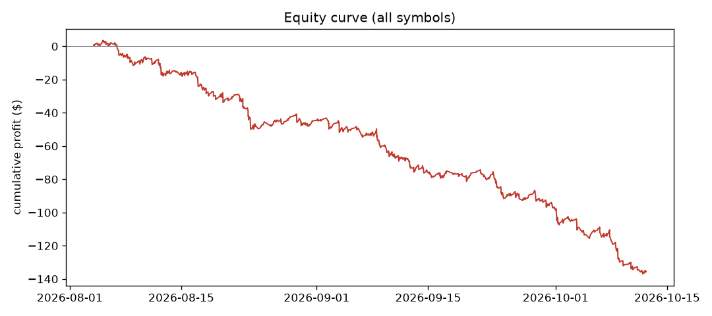
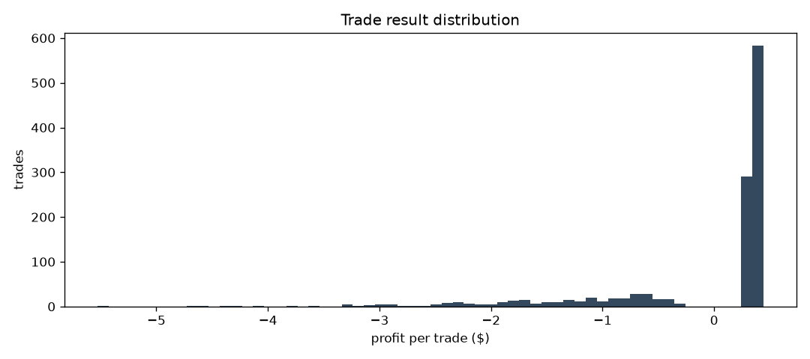
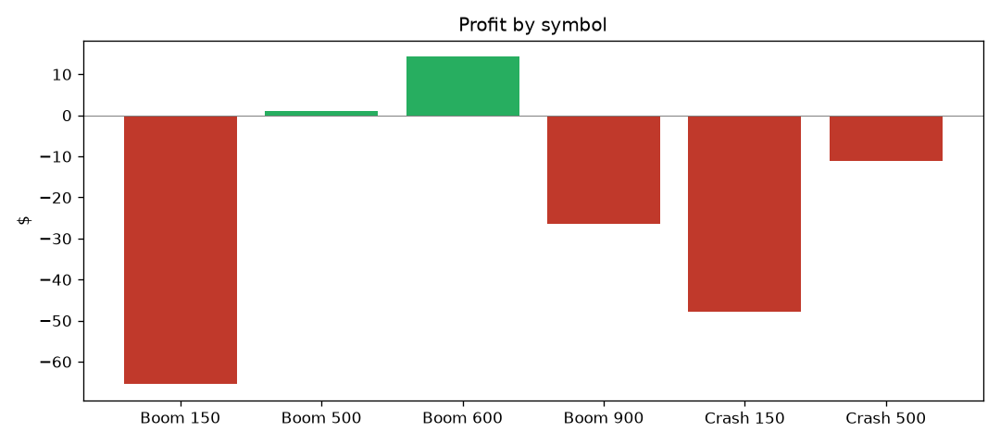
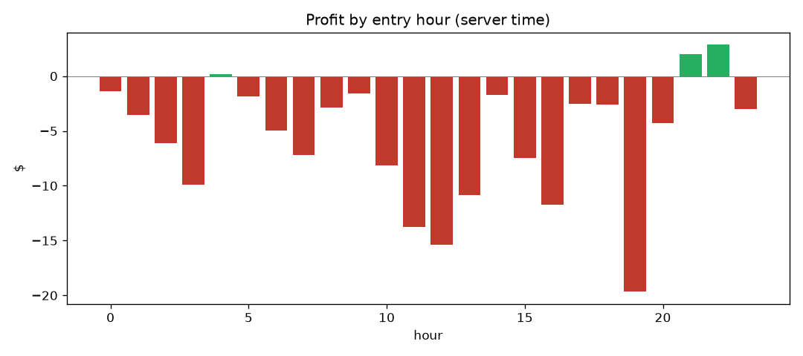
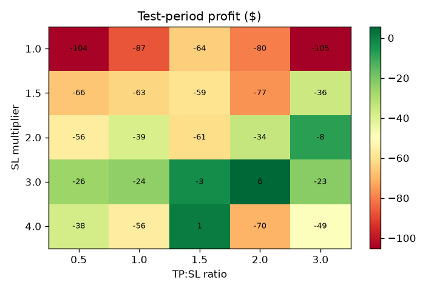

# Backtest report: Boom/Crash EMA scalper

Period tested: 4 Aug to 12 Oct 2026 (70 days), 6 symbols, 1,194 simulated trades.
Everything here can be reproduced with `backtest.py` and `analyze.py`. Raw numbers are in `results/analysis_output.txt`.

## 1. Summary

- **The strategy loses money: −135 $ over 70 days** (profit factor 0.70, 50 of 70 days negative).
- **It wins often but loses badly.** 73% of trades win, but a win pays 0.36 $ and a loss costs 1.40 $. One loss erases about 4 wins. To break even it would need to win 80% of the time.
- **Spikes cause the damage.** When a Boom/Crash spike hits, the price jumps far past the stop-loss. 75% of all money lost comes from this jump, not from the stop being hit at its planned level.
- **The backtest can be trusted as a guide.** On your real log (349 trades, 28 Jun to 12 Aug) the bot had a 72% win rate, an average win of 0.33 $ and an average loss of 1.20 $, for −35 $. The backtest gives 73%, 0.36 $ and 1.40 $. They are close, and both lose. The backtest is slightly harsher on losses.
- **Tuning the exits does not fix it.** No stop/target combination was profitable on both halves of the data.
- **The EMA rules add very little.** Random entries lose 0.16 $ per trade, the EMA rules lose 0.11 $.
- **Two symbols cause most of the loss.** Boom 150 and Crash 150 lose 113 $ of the 135 $.
- **Best next step:** move away from instruments with spikes. See `STRATEGY_PLAN.md`.

## 2. Where the money is lost

| | Value |
|---|---|
| Trades | 1,194 (873 wins, 321 losses) |
| Win rate | 73.1% |
| Average win | +0.36 $ |
| Average loss | −1.40 $ |
| Wins needed to pay for one loss | 3.9 |
| Break-even win rate | 79.6% |
| Expected result per trade | −0.11 $ |

The curve falls steadily with short flat stretches. There is no single bad event: the strategy loses a little each week (all 10 full weeks were negative).

The histogram shows the problem in one picture: a tall block of small wins on the right and a long tail of large losses on the left.

## 3. The spike problem

When a trade is stopped out, it does not exit at the stop price. The stop is a few points away from the entry, and a Boom/Crash spike is many times larger, so the price jumps over it.

| | Value |
|---|---|
| Stopped-out trades | 321 |
| Total lost on them | −448.75 $ |
| Loss if every stop had filled at its planned price | −110.05 $ |
| Extra loss from jumping past the stop | **−338.70 $ (75%)** |
| Losses that overshoot the stop by more than 2× its size | 184 of 321 (57%) |
| Typical overshoot | 2.5× the stop size (worst 14.6×) |
| Losses that happen in the first minute | 70% |

So the bot is hit by a spike soon after entry, and a spike costs several times what the stop was meant to limit. A tighter or wider stop does not change the size of the spike.

Spread costs are smaller: 37 $ over all trades.

## 4. Results by symbol

| Symbol | Trades | Win rate | Avg win | Avg loss | Profit factor | Profit |
|---|---|---|---|---|---|---|
| Boom 150 | 216 | 70% | 0.26 | −1.65 | 0.38 | **−65.5 $** |
| Boom 500 | 158 | 73% | 0.40 | −1.08 | 1.02 | +1.0 $ |
| Boom 600 | 201 | 80% | 0.40 | −1.25 | 1.29 | **+14.3 $** |
| Boom 900 | 221 | 79% | 0.40 | −2.10 | 0.73 | −26.4 $ |
| Crash 150 | 189 | 73% | 0.25 | −1.62 | 0.42 | **−47.8 $** |
| Crash 500 | 209 | 63% | 0.44 | −0.88 | 0.84 | −11.0 $ |

Why the 150 indices are the worst:
- Their spread is about **22% of the stop size**, against 3–5% on the others. A fifth of the stop is gone the moment the trade opens.
- A normal one-minute candle on these indices is **1.7 times taller than the stop** (0.2–0.3 on the others). The stop is inside normal price noise, so it gets hit by ordinary movement and not only by spikes.

Removing both 150 indices leaves the other four at about −22 $. That is much better, but still negative.

Only Boom 600 is clearly positive, and with 201 trades that may be luck.

## 5. When it loses

- **By hour:** almost every hour is negative, and the few positive hours (4, 21, 22) have very small totals. There is no good time of day to trade this strategy.
- **By weekday:** all seven days are negative.
- **By week:** all 10 full weeks are negative. The worst was −30.6 $ (17 to 23 Aug).
- **By day:** 20 positive days, 50 negative. The best day was +3.38 $, the worst −13.50 $. The +3 $ daily stop caps the good days, but not the bad ones.
- **Streaks:** the longest losing streak is only 5 trades. The win rate after a loss (72%) is the same as after a win (74%), so losses are not clustered.

## 6. Do the entry rules help?

| Entry rule | Trades | Win rate | Profit | Per trade |
|---|---|---|---|---|
| Full rules (M15 trend + M5 EMA cross) | 1,194 | 73.1% | −135 $ | −0.113 $ |
| Without the M15 trend filter | 1,598 | 72.8% | −181 $ | −0.113 $ |
| Random entry on every M5 candle | 47,280 | 70.2% | −7,564 $ | −0.160 $ |

The EMA rules improve each trade by about 0.05 $ against random entry, which is small. The M15 filter doesn't improve the average trade. It only reduces how many trades happen.

Time since the last spike was also tested. A spike gives no warning on Boom/Crash, and the data agrees: win rates are 73–74% whether the last spike was 5–15 min, 15–60 min, or over an hour earlier.

## 7. Exit settings

Tested stop sizes of 1× to 4× the current ones, and TP:SL ratios from 0.5 to 3. The data was split in two: first half (4 Aug to 7 Sep) and second half (7 Sep to 12 Oct). A setting is only believable if it makes money in both halves.

- **Nothing is profitable in both halves.** The best test-half result is +5.8 $ (stop 3×, ratio 2), and that same setting lost 14.9 $ in the first half.
- Larger stops lose less in dollars, but mostly because the bot sizes the lot to risk a fixed 0.30 $, so wider stops mean smaller positions and smaller numbers overall.
- A small target (ratio 0.5) raises the win rate to 72–79% but the losses still cost more than the wins.
- A large target (ratio 3) cuts the win rate to 30–49%, and the spike losses still arrive.

Full grid: `results/sweep_exit.csv`.

## 8. Opposite direction

If buying Boom and selling Crash were the better way, the results would show it. It is far worse: **20% win rate and −391 $**, with all six symbols losing. The current direction (Boom sell, Crash buy) is correct. The small price moves between spikes do go the way the bot expects, but spikes take back more than those moves pay.

Full grid: `results/sweep_inverse.csv`.

## 9. Risk rules

- **Daily +3 $ stop:** with it, −135 $; without it, −149 $. It helps slightly by ending good days, but it does not fix the loss.
- **Lot sizing:** the goal is a 0.30 $ risk per trade. Because of minimum lots, the planned risk is 0.37–0.45 $ on Boom 500, 600 and 900. The real risk is much larger, because losses average 4 times the planned amount.

## 10. What the backtest cannot show

- **Spike filter.** The live filter uses tick data and is not simulated. The live bot may skip a few of the entries counted here.
- **Spike fill price.** Stopped-out trades are filled at the candle's worst price. This is cautious: losses in the backtest average 1.40 $ against 1.20 $ live. If the real figure is 1.20 $, the break-even win rate is still 78%, above the 73% achieved. So the conclusion does not change.
- **Only 70 days** of one-minute data (a terminal limit of 100,000 candles), in one market period.
- **Boom/Crash prices are random.** A profitable backtest is a hint, not a promise. A losing one is a warning.
- **Stops:** if a candle touched both target and stop, the trade is counted as a loss.

## 11. Conclusion

The strategy has no edge on Boom/Crash at these settings. The gains between spikes are real but small, and each spike costs several times more. Tuning stops, targets, hours or entry rules does not change that. Changes that would help are those that remove or avoid the spike loss. See `STRATEGY_PLAN.md`.
